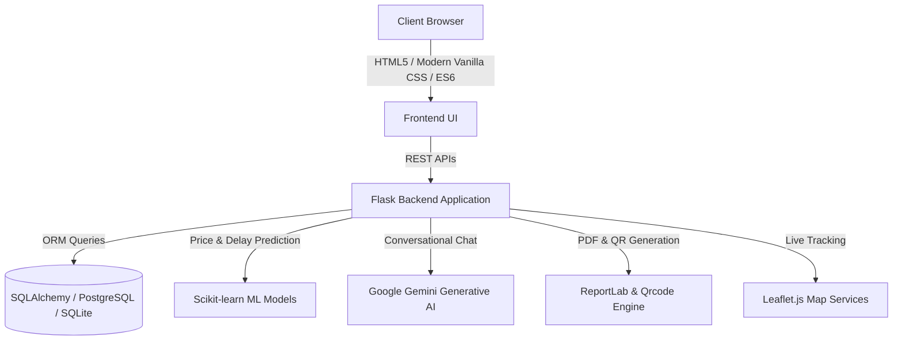

# 🚌 SmartBus AI — Future of Intelligent Bus Travel & Route Optimization

[](https://www.python.org/)
[](https://flask.palletsprojects.com/)
[](https://scikit-learn.org/)
[](https://deepmind.google/technologies/gemini/)
[](https://leafletjs.com/)
[](https://opensource.org/licenses/MIT)

> **SmartBus AI** is a next-generation smart transportation platform combining **Machine Learning**, **Graph-based Route Optimization**, and **Generative AI** to deliver the fastest, most cost-effective, and sustainable intercity bus journeys.

---

## 🌟 Key Features

### 🧠 1. AI Route Optimizer & Multi-Hop Split Routing
- **Smart Graph Solver:** Identifies the fastest and most affordable direct and connecting routes using intelligent graph algorithms.
- **Split-Journey Optimizer:** Discovers smart connecting routes with optimal layovers when direct buses are sold out or unavailable.

### 📈 2. ML Fare & Delay Prediction Engine
- **Dynamic Fare Intelligence:** Predicts price trends, surge conditions, and best booking windows powered by **Scikit-learn**.
- **Real-Time Delay Forecaster:** Estimates arrival delays using historical route data, weather parameters, and traffic metrics.

### 🤖 3. Gemini-Powered AI Travel Assistant
- Floating conversational AI chatbot integrated with **Google Generative AI (Gemini)**.
- Understands natural language travel queries, suggests optimal departure times, and assists in planning journeys.

### 🗺️ 4. Live GPS Bus Tracking & Fleet Radar
- Real-time bus location tracking on interactive **Leaflet.js** maps.
- Live radar pings, upcoming stop announcements, and real-time ETAs.

### 💺 5. Interactive 3D Seat Selection & Cockpit View
- Immersive visual seat layout with sleeper and semi-sleeper configurations.
- Real-time seat occupancy visualization and 360-degree virtual cockpit preview.

### 🌱 6. Eco-Rewards & Carbon Offset Tracker
- Calculates estimated $CO_2$ emissions saved compared to air or private car travel.
- Gamified green reward points, milestones, and sustainable travel tier badges.

### 🛡️ 7. Safety Ratings & Women-Safety Metrics
- Safety scoring system evaluating coach maintenance, verified driver records, and night-travel safety index.
- Dedicated safety features for solo women travelers.

### 🎟️ 8. Instant UPI Payment & Dynamic QR Tickets
- Seamless digital payment integration supporting UPI.
- Auto-generates downloadable **PDF Boarding Passes** with verifiable **QR codes** using ReportLab.

### 🎬 9. Cinematic Canvas Intro Experience
- High-performance HTML5 Canvas animation featuring night road simulations, skyline parallax, AI scanner HUD brackets, and kinetic typography.

### 🔐 10. Admin Fleet & Operations Dashboard
- Role-based administrative dashboard for managing routes, coaches, drivers, passenger verification, and revenue analytics.

---

## 🏗️ Architecture & Tech Stack



### 💻 Technologies Used
| Layer | Technology |
|---|---|
| **Backend** | Python 3, Flask, Flask-SQLAlchemy, Flask-JWT-Extended, Flask-Bcrypt, Flask-Migrate |
| **Machine Learning** | Scikit-learn, Pandas, NumPy |
| **Generative AI** | Google Generative AI (Gemini 1.5 / Pro) |
| **Frontend** | Semantic HTML5, Vanilla CSS (Glassmorphism Design System), JavaScript (ES6+), HTML5 Canvas 2D |
| **Mapping & Visuals** | Leaflet.js, Chart.js, FontAwesome 6 |
| **Database & Cache** | PostgreSQL / SQLite, Redis |
| **PDF & Tickets** | ReportLab, Python-QRCode |
| **Production Server** | Gunicorn, Waitress, Render |

---

## ⚡ Quick Start Guide

### 1. Prerequisites
- Python 3.10 or higher
- Git

### 2. Clone the Repository
```bash
git clone https://github.com/vinayvamsilanka/smartBus.git
cd smartBus
```

### 3. Create and Activate Virtual Environment
```bash
# Windows
python -m venv venv
venv\Scripts\activate

# macOS / Linux
python3 -m venv venv
source venv/bin/activate
```

### 4. Install Dependencies
```bash
pip install -r requirements.txt
```

### 5. Configure Environment Variables
Create a `.env` file inside the `backend/` directory:
```env
FLASK_APP=run.py
FLASK_ENV=development
SECRET_KEY=your_secret_key_here
JWT_SECRET_KEY=your_jwt_secret_key_here
GEMINI_API_KEY=your_google_gemini_api_key_here
```

### 6. Initialize Database & Seed Sample Data
```bash
python backend/init_db.py
python backend/seed_cities.py
python backend/seed_real_world.py
```

### 7. Run the Live Application
```bash
python backend/run.py
```
Visit **`http://127.0.0.1:8000`** in your browser to explore SmartBus AI!

 EXPERIENCE THE FUTUR EOF TRAVEL--> https://smartbus-ai-r4ay.onrender.com/

---

## 🤝 Contributing

Contributions are warmly welcome!
1. Fork the Project
2. Create your Feature Branch (`git checkout -b feature/AmazingFeature`)
3. Commit your Changes (`git commit -m 'Add some AmazingFeature'`)
4. Push to the Branch (`git push origin feature/AmazingFeature`)
5. Open a Pull Request

---

## 📄 License

Distributed under the **MIT License**. See `LICENSE` for more information.
